# SDN DoS Detection & Mitigation | Ryu · Mininet · OpenFlow 1.3

    

**Progetto di Networks and Cloud Infrastructures** — Corso di Laurea Magistrale in Ingegneria Informatica, Università degli Studi di Napoli Federico II, a.a. 2023–2024.  
**Autori:** Luca Migliaccio, Mario Migliuolo · **Docente:** Prof. Giorgio Ventre.

> **TL;DR** — Realizzazione e valutazione di un firewall SDN contro traffico DoS simulato. Mininet emula la rete; Ryu controlla gli switch Open vSwitch tramite OpenFlow; la mitigazione usa statistiche RX sulle porte e regole di blocco per porta o IP. Le figure qui sotto sono **quelle originali della relazione**, estratte dal documento Word, non mockup o nuove misurazioni.

## Topologie usate nell'elaborato

### Topologia 1 — 3 host / 4 switch

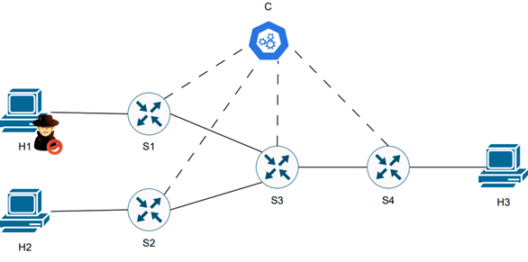

- **h1**: sorgente UDP ad alto bitrate (attaccante simulato); **h2**: traffico TCP legittimo; **h3**: server di destinazione.
- **s1–s4**: switch Open vSwitch, controllati da Ryu; collegamenti inter-switch con capacità di 3 Mbps nel primo esperimento.

### Topologia 2 — estensione con h4

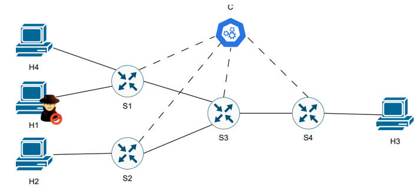

- Aggiunge **h4**, host legittimo connesso allo switch `s1`, per valutare l'effetto collaterale di un blocco indiscriminato del collegamento/porta.
- La relazione approfondisce blocco dinamico, traffico variabile e blocco per IP.

### Scenario alternativo: blocco del collegamento S1–S3

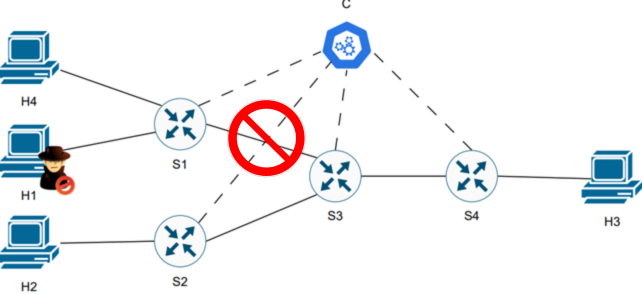

## Risultati sperimentali originali

Le figure sono screenshot di **Wireshark I/O Graphs** e console acquisiti durante gli esperimenti universitari. Non sono una nuova campagna sperimentale: non sono disponibili i PCAP o le misure numeriche grezze.

### 1 · Traffico senza mitigazione

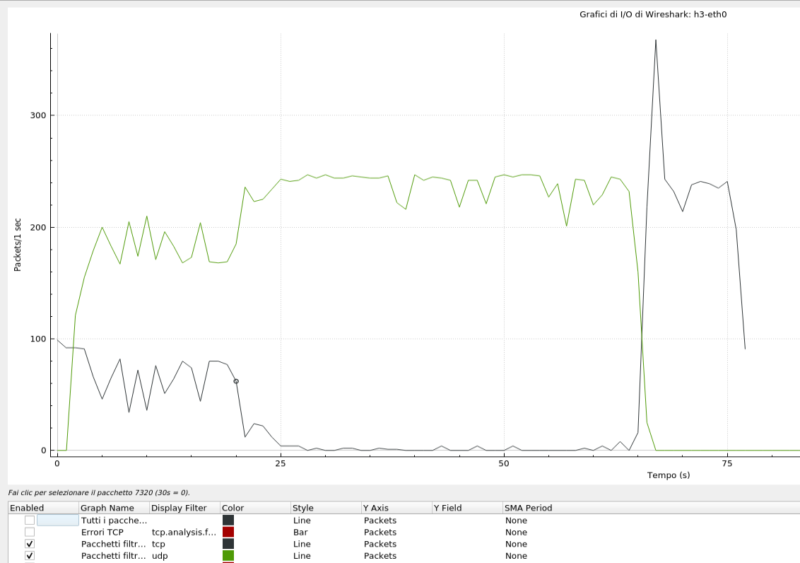

Nello scenario senza firewall, il traffico UDP satura la capacità condivisa e interferisce con il flusso TCP legittimo. Nella relazione si osserva il recupero del traffico TCP dopo il termine dell'invio UDP (~55 s nella cattura descritta).

| Ritrasmissioni TCP | Segmenti persi / non catturati |
|---|---|
| 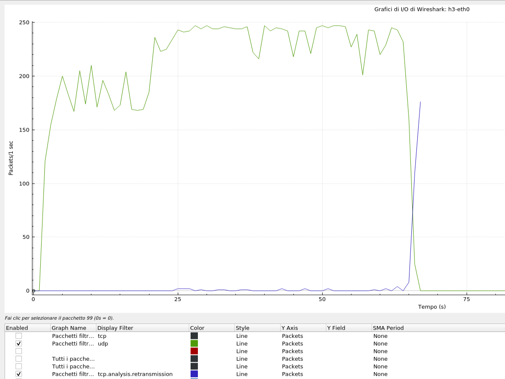 | 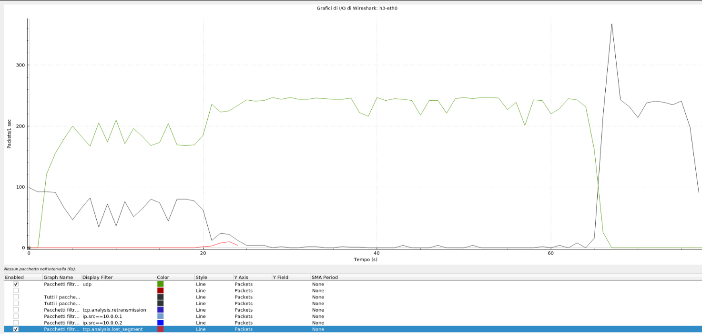 |

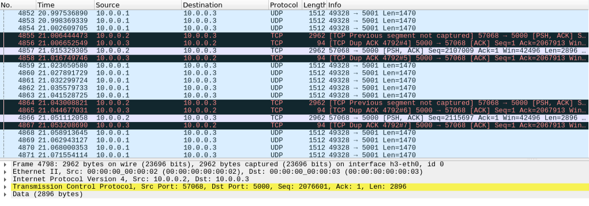

### 2 · Prima mitigazione: blocco porta

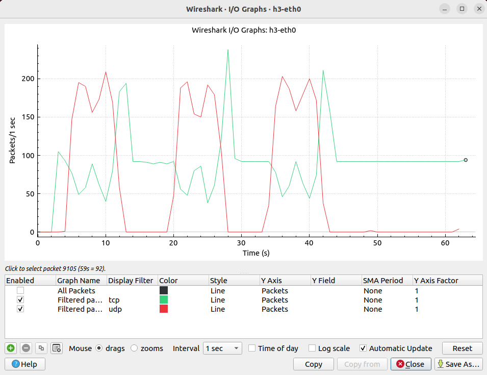

L'approccio sfrutta una mappatura JSON delle porte di accesso degli host, per distinguere il traffico originato da un host dai transiti sugli switch intermedi.

### 3 · Seconda topologia: traffico e blocco dinamico

| Test con traffico costante | Test a bitrate variabile |
|---|---|
| 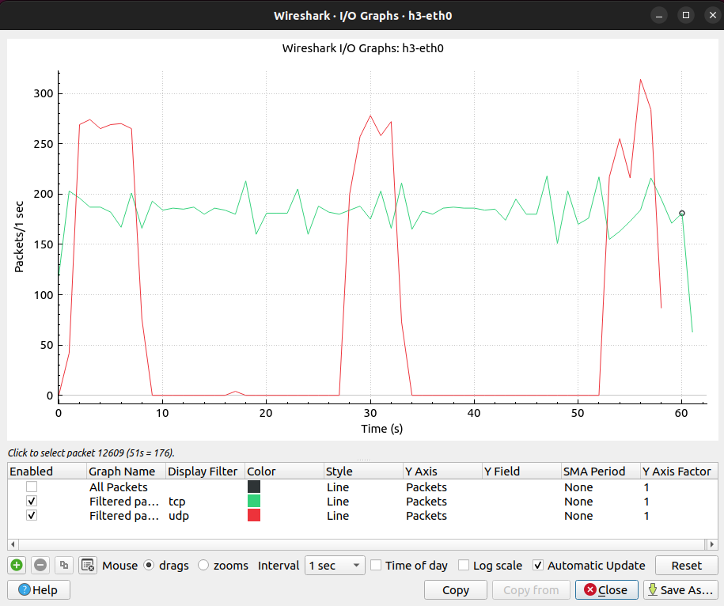 | 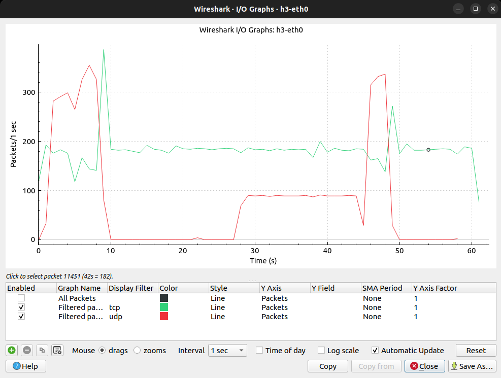 |

Il test variabile usa **4 → 1 → 6 Mbps**, con **20 secondi per fase** e **1 secondo di pausa** tra le fasi, come nello script Bash originale.

### 4 · Mitigazione dinamica e blocco IP

| Controller dinamico | Blocco IP sorgente |
|---|---|
| 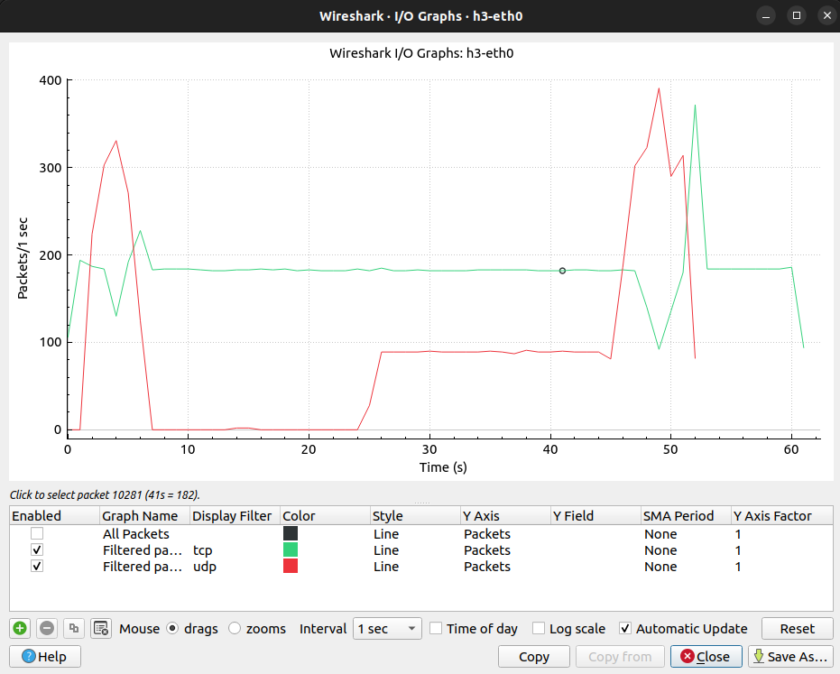 | 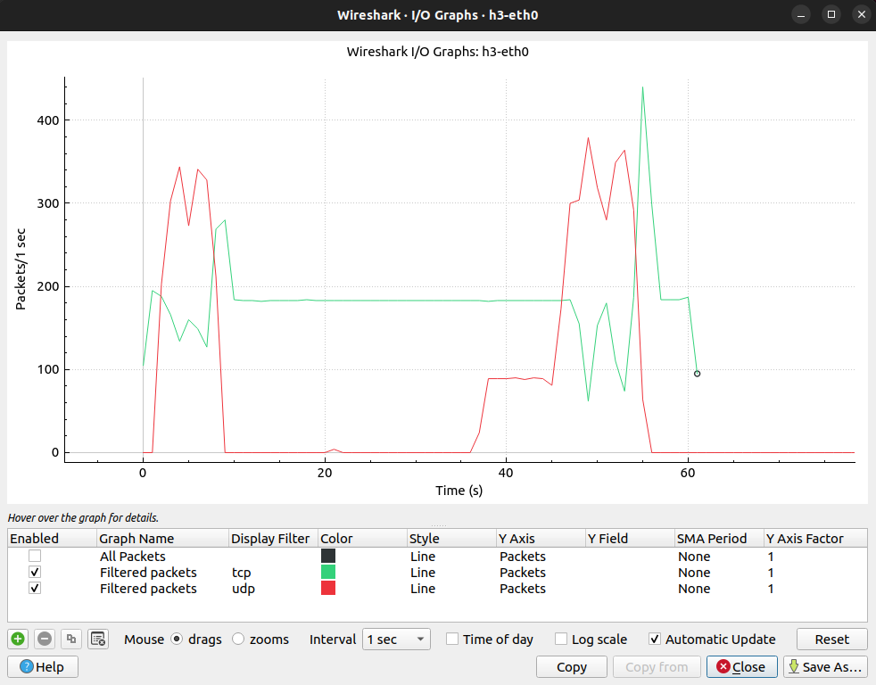 |

Le immagini mostrano gli andamenti del traffico acquisiti nell'elaborato, ma **non** dimostrano da sole robustezza generale, accuratezza di detection o assenza di falsi positivi.

## Come funziona il controller

1. Ryu riceve le statistiche `OFPPortStatsReply` dagli switch OpenFlow.
2. Ogni **5 secondi** calcola il throughput RX stimato: `((rx_bytes_attuali − rx_bytes_precedenti) × 8) / 5` bit/s.
3. Se RX supera la soglia sperimentale di **2 Mbps**, confronta switch/porta con una mappatura statica JSON degli host.
4. In base alla variante aggiunge una regola OpenFlow di priorità 2 con azione di drop (`[]`), associata a una **porta di ingresso** oppure all'**IPv4 sorgente**.
5. Le varianti attivano lo sblocco dopo 10 s o applicano una logica aggiuntiva di rivalutazione della condizione di congestione.

⚠️ Questa logica rileva **traffico sopra soglia**, non identifica necessariamente un attacco DoS: traffico legittimo intenso potrebbe essere classificato in modo errato. Si tratta di un prototipo per rete emulata, **non di un IPS pronto per produzione**.

## Struttura dei file

```text
sdn-dos-mitigation/
├── README.md
├── controllers/
│   ├── controller_original.py              # originale caricato: baseline, typo noto
│   ├── controller_baseline_fixed.py         # copia con correzione di 1 typo
│   ├── baseline_learning_switch.py         # precedente ricostruzione, solo riferimento
│   ├── controller_host_info_json_v3.py      # blocco porta a durata fissa
│   ├── controller_host_info_json_FINALE.py  # blocco porta con logica dinamica
│   └── controller_host_info_json_IP_v4.py   # blocco IP
├── topologies/
│   ├── topology_original.py                # originale caricato: rete 2 host / 3 switch
│   ├── topology_1.py                       # ricostruita dalla relazione: 3 host / 4 switch
│   └── topology_2.py                       # ricostruita dalla relazione: 4 host / 4 switch
├── config/                                 # tutti i JSON originali
├── scripts/                                # script bitrate originale + headless
├── assets/
│   ├── original-report/                    # 90 figure originali dal DOCX
│   └── diagrams/                           # schemi SVG aggiuntivi
├── docs/
│   ├── Elaborato_NCIs_original.docx        # elaborato originale, integrale
│   ├── Elaborato_NCIs.pdf                  # PDF già fornito
│   ├── REPRODUCIBILITY.md                  # guida VM Ubuntu 22.04
│   ├── IMAGE_INDEX.md                      # indicizzazione figure
│   └── LIMITATIONS.md                      # criticità e limiti
└── results/                                # spazio per nuove misure
```

**Importante:** il file `topology.py` originale ricevuto è una **topologia diversa**, composta da 2 host e 3 switch, e non coincide con le topologie 1/2 raffigurate nella relazione. Le topologie relative agli esperimenti sono quindi contrassegnate come **ricostruite dalla relazione**, non spacciate per file originali. Il file `controller.py` originale contiene invece un typo che ne compromette l'esecuzione: si usa la copia `controller_baseline_fixed.py` e l'originale rimane invariato.

## Riprodurre gli esperimenti su Ubuntu 22.04

Procedura completa: **[REPRODUCIBILITY.md](docs/REPRODUCIBILITY.md)**. Eseguire soltanto nella VM di laboratorio.

### Installazione

```bash
sudo apt update
sudo apt install -y git mininet openvswitch-switch python3 python3-pip python3-venv iperf xterm tcpdump wireshark nload d-itg
python3 -m venv --system-site-packages .venv
source .venv/bin/activate
pip install 'ryu==4.34'
```

La versione Ryu indicata è una **proposta di setup**, non una configurazione già verificata. Eventuali incompatibilità Python/eventlet vanno risolte e registrate nella VM.

### Avviare baseline topologia 1 (due terminali)

```bash
# Terminale 1, dalla root del repository
source .venv/bin/activate
ryu-manager --ofp-tcp-listen-port 6653 controllers/controller_baseline_fixed.py

# Terminale 2, dalla root del repository
sudo python3 topologies/topology_1.py
```

Nel prompt `mininet>`:

```text
h3 iperf -s -u -p 5001 &
h3 iperf -s -p 5000 &
h2 iperf -c 10.0.0.3 -p 5000 -t 60 &
h1 iperf -c 10.0.0.3 -u -b 3M -p 5001 -t 60 &
```

**3 Mbps** è il bitrate della prova baseline riportata nel documento. Per la sequenza variabile consultare la guida e lo script `scripts/bitrate_var_headless.sh`. Al termine: `exit`, quindi `sudo mn -c`.

## Documentazione e avvertenze

- [Procedura dettagliata di riproduzione](docs/REPRODUCIBILITY.md)
- [Indice delle 90 immagini originali](docs/IMAGE_INDEX.md)
- [Limitazioni e controlli](docs/LIMITATIONS.md)
- [Elaborato universitario originale in Word](docs/Elaborato_NCIs_original.docx)
- [Elaborato in PDF](docs/Elaborato_NCIs.pdf)

Le immagini sono originali del documento; l'estrazione non ne aumenta la risoluzione. Per catture `.pcap`, grafici quantitativi ri-esportati o test automatizzati servono gli artefatti sperimentali originali o nuovi test sulla VM.

## Crediti, licenza e pubblicazione

**Luca Migliaccio e Mario Migliuolo** · *Networks and Cloud Infrastructures*, prof. Giorgio Ventre, Università degli Studi di Napoli Federico II. Prima di rendere pubblica la repository concordare attribuzione/licenza e controllare la presenza di matricole o informazioni personali nella relazione. Il sorgente baseline deriva dall'esempio di Ryu con intestazione Apache-2.0: preservarne gli avvisi originali. Non è stata assegnata una licenza generale senza autorizzazione dei coautori; vedere [LICENSE-NOTE.md](LICENSE-NOTE.md).
